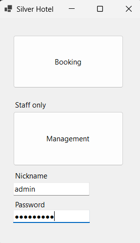
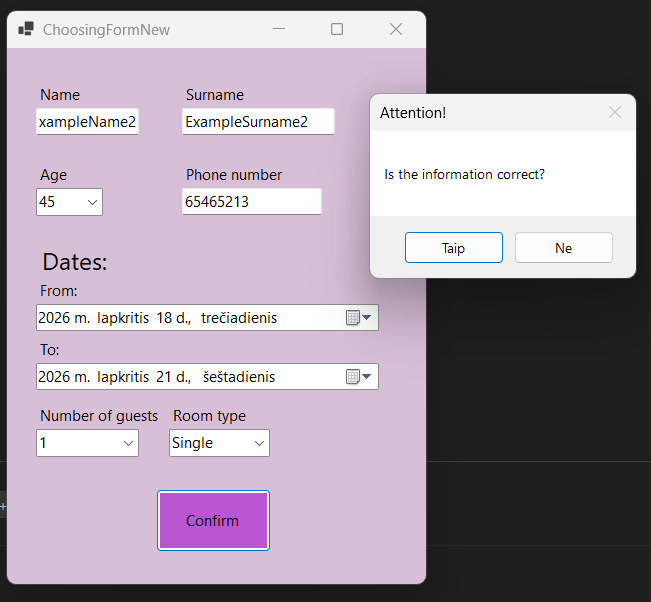
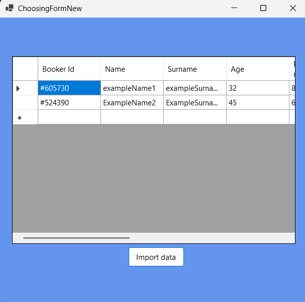

# Hotel Management Simulation

A desktop hotel booking application built with **C# and Windows Forms** in 2022 as an early programming project. It demonstrates basic user interface design, a booking workflow, and persistent data storage using a text file instead of a database.

> **About this project:** Developed as a learning exercise before studying SQL. Reservations are stored locally in `BookingData.txt`, which serves as a simple database simulation. This is not a production hotel management system.

## Screenshots

### Main menu
The starting screen provides access to the booking form and a staff-only management area.

### Booking form
Guests can enter their contact information and select their stay dates, number of guests, and room type.

### Management panel
The staff view displays booking records imported from the local text file.

## Features

- **Guest bookings:** Enter a name, surname, age, phone number, check-in/check-out dates, number of guests, and room type.
- **Booking identifiers:** Generate a random booking reference and save the booking timestamp.
- **File-based storage:** Write booking records to a local text file using `|` as a separator.
- **Management view:** Import saved records and display them in a Windows Forms `DataGridView`.
- **Demo staff login:** Access the management interface using preset demonstration credentials.

## Technologies

- **C#**
- **Windows Forms**
- **.NET 5** (Windows desktop)
- **System.IO** for reading and writing local text files

## How to run

1. On **Windows**, install **Visual Studio** with the **.NET desktop development** workload and the components required for the project's .NET 5 target.
2. Download or clone this repository.
3. Open `HotelManagement.sln` in Visual Studio.
4. Build and run the application (`F5`).
5. Create a booking, then open the management area to import and view saved bookings.

### Demo staff credentials

| Field | Value |
| --- | --- |
| Username | `admin` |
| Password | `Hoteldemo` |

These credentials are hardcoded only for demonstration purposes. This login approach is **not secure for production use**.

## How data storage works

The application writes reservation information as text records separated by `|` characters. The management interface reads these records and displays them in a table.

This intentionally simplified approach helped me practice saving, retrieving, and displaying data before learning relational databases and SQL. `BookingData.txt` is excluded from Git to avoid publishing guests' personal details.

## Project background

This project was created in **2022** as an early C# learning exercise. It helped me understand form-based applications, event-driven programming, and persistent local data storage. The original application was developed without AI assistance.

**Limitations:** This is a portfolio/learning project, not a production-ready booking system. Input validation is limited, booking references are randomly generated, and the demonstration login does not provide secure authentication. It targets an older version of .NET.
